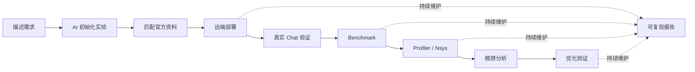

<div align="center">

# Inference Service Automation

**面向真实算力环境的大模型推理服务自动化 Skill**<br>
**AI-native automation for production LLM inference experiments**

从一句需求开始，自动完成环境准备、远端部署、真实问答验证、Benchmark、
Profiler / Nsys 采集、瓶颈分析与优化验证。

[](https://www.python.org/)
[](#支持范围)
[](#支持范围)
[](#项目状态)

[立即使用](#立即使用) · [能力范围](#能力范围) · [工作流程](#工作流程) · [交付产物](#交付产物)

</div>

---

## 这是什么

Inference Service Automation 是一套由 AI 直接使用的推理服务实验 Skill。

你只需要告诉 AI 想在什么硬件上，用什么模型和框架完成什么任务。AI 会读取 [`SKILL.md`](SKILL.md)，代办目录创建、配置初始化、远端工程生成、命令执行、结果验收和报告整理；需要由你提供的环境信息，AI 会集中写入配置表并给出填写指引。

它交付的是一个**可配置、可验证、可复现**的实验，而不是一组临时命令。

## 立即使用

把需求直接交给 AI：

```text
使用 inference-service-automation：
在 H20 上用 SGLang 单服务部署 Qwen3-30B-A3B，
完成真实 chat 验证后运行 ISL=1024、OSL=512、并发 1/4/8 的 benchmark。
```

就这么简单。

你不需要手动：

- 创建实验目录；
- 复制模板或配置文件；
- 调用项目生成器；
- 拼装 Docker、服务、Benchmark 或 Profiling 命令；
- 整理日志、结果目录和复现报告。

AI 会自动创建并预填配置，但部分内容仍需要你确认或填写：

- `servers.toml`：工作区的硬件平台和候选 SSH 主机清单；不存在时由 AI 创建，已有明确值时由 AI 预填。
- `environment.toml`：单个实验的远端工作目录、模型路径和主机入口；AI 在确认实验身份后创建，你补全无法从需求确定的环境值。
- `experiment.toml`：AI 根据官方配置或迁移候选生成的实验设计表；你可以查看、修改，并明确要求 AI 应用新版本。

配置未填写完整前，AI 不会连接远端或提前生成完整工程。你也可以明确要求 AI 根据你提供的信息代填，或授权其通过只读探测补全指定字段。

### 更多需求示例

**只部署并验证**

```text
在 Ascend 910C 上用 vLLM 部署 Qwen3-30B-A3B。
服务上线并完成一次真实问答后停止，不运行压测。
```

**运行基线压测**

```text
对当前实验运行 benchmark：ISL=1024、OSL=512，并发 1/4/8，
每档 20 个正式请求，首轮关闭 prefix cache。
```

**采集性能数据**

```text
在并发 8 下运行 PyTorch Profiler 和 Nsys。
Profiler 不生成 native key_averages，完成后验收并回收核心产物。
```

**分析瓶颈**

```text
分析当前实验已有的 Profiler 和 Nsys 结果，
区分事实、推断和待验证项，给出按优先级排列的优化建议。
```

**完成一次优化闭环**

```text
以提升吞吐且不显著恶化 TPOT 为目标，基于现有分析设计一个联合优化候选。
保持 benchmark 负载不变，完成正确性验证和基线对比。
```

## AI 会做什么

一次任务通常包含以下自动化工作：

1. 从需求中识别硬件、模型、框架、部署方式和任务边界。
2. 自动建立隔离的实验目录、初始化配置，并引导你补全必要的环境字段。
3. 从已收录的平台官方入口定位当前版本和精确模型资料。
4. 在目标服务器生成工程、检查资源冲突并启动服务。
5. 按模型的真实输入约定完成生成请求验证。
6. 只执行你要求的 Benchmark、Profiler、Nsys、分析或优化阶段。
7. 验收原生产物，维护用户可编辑设计表和唯一正式报告。
8. 汇报实际配置、核心结果、证据路径和合理的下一步。

如果缺少依赖、需要下载额外资源、扩大资源范围或可能影响其他任务，AI 会先说明影响并等待授权。

## 工作流程



各阶段彼此独立。只要求部署时，流程会在服务健康并完成真实生成验证后结束，不会擅自继续压测或采集。

## 能力范围

- **部署与验证**：单服务、双节点、Prefill–Decode 分离及平台专用拓扑。
- **真实性能压测**：自定义输入/输出长度、并发档位、请求规模与数据集。
- **性能采集**：PyTorch Profiler，以及受支持 NVIDIA 环境中的 Nsight Systems。
- **证据化分析**：计算、通信、调度、空闲、长尾和阶段覆盖分析。
- **优化闭环**：配置、推理框架源码、算子或联合候选的正确性和性能对比。
- **多 Agent 协同**：按硬件类型组织 design、execute、analyze 角色。
- **干净交付**：本地只保留用户配置、正式报告、必要结果和实际修改源码。

### 阶段口令

| 你的请求 | 完成边界 |
| --- | --- |
| `部署一下` | 服务健康，并完成符合模型输入约定的真实生成请求 |
| `压测` / `benchmark` | 按确认的负载生成可解析结果 |
| `跑 profiler` | 运行 PyTorch Profiler 并验收本轮 Trace |
| `跑 nsys` | 运行 Nsight Systems 并保留可打开的 `.nsys-rep` |
| `跑 profiling` | 依次完成 PyTorch Profiler 与 Nsys |
| `分析 profiler 结果` | 只分析已有 PyTorch Trace，不启动新采集 |
| `分析 nsys 结果` | 按 Nsys 专用证据流程分析已有报告 |
| `分析瓶颈` | 综合已有采集结果形成瓶颈结论 |
| `优化` | 在确认目标、范围、预算和基线后验证优化候选 |
| `项目暂停` / `项目结束` | 清理可证明属于本实验的运行态，保留工程与结果 |

## 支持范围

| 维度 | 当前能力 |
| --- | --- |
| 推理框架 | SGLang、vLLM，以及平台专用运行时的适配流程 |
| 部署拓扑 | Single、Dual、Prefill–Decode 分离及配置化多机拓扑 |
| 已维护平台导航 | NVIDIA CUDA、Ascend NPU、Moore Threads MUSA、AMD ROCm、Intel XPU、Google TPU、Apple Metal、CPU |
| 性能测试 | OpenAI 兼容服务负载、并发 Benchmark、关闭 Prefix Cache 的首轮基线 |
| Profiling | PyTorch Profiler；受支持 NVIDIA 环境中的 Nsight Systems |
| 优化范围 | 服务配置、推理框架源码、算子或联合候选 |

> [!NOTE]
> 平台导航表示项目已经收录对应官方资料入口，不等于所有“硬件 × 模型 × 框架 × 版本”组合都经过真实部署验证。AI 会针对当前组合核对资料并以实际运行结果为准。

完整平台导航见 [`platforms/README.md`](platforms/README.md)。

## 交付产物

每个实验使用独立目录：

```text
<workspace>/<hardware>/<model>/<framework>/<deployment>/
├── environment.toml              # 环境与远端入口
├── experiment.toml               # 用户可查看和修改的实验设计
├── <title>.md                     # 唯一正式报告
├── profiling_results/            # 实际开展采集时存在
└── tuning/<study>/               # 实际开展优化时存在
```

正式报告按实际开展的阶段组织：

```text
启动服务 → Baseline 压测 → Profiling → 优化 1 → 优化 2 → ...
```

报告展开真实执行命令、自定义源码和结果；即使脱离远端工程，也能复现已经记录的流程。

## 项目结构

```text
.
├── SKILL.md                       # AI 总编排入口
├── benchmark/                     # Benchmark Skill
├── profiling/                     # Profiling 与 Nsys 分析 Skill
├── platforms/                     # 八类平台官方资料与获批经验
├── multi-agent/                   # Agent 角色和调度协议
├── references/                    # 配置、流程、交付、分析与调优规范
├── scripts/                       # 生成、校验、收集与对比工具
├── scripts/templates/             # 单服务与 PD 工程模板
└── example/                       # 完整参考工程
```

## 设计原则

- **官方资料优先**：先从已收录入口定位目标版本和模型，缺口再检索。
- **部署优先**：完成最小安全检查后直接启动，用实际日志定位问题。
- **阶段隔离**：未请求的 Benchmark、Profiling、分析和优化不会自动执行。
- **基线可信**：首轮 Benchmark 关闭 Prefix Cache，避免缓存掩盖真实表现。
- **资源安全**：不抢占、停止或删除归属不明的进程和容器。
- **证据分层**：官方资料、静态检查、示例历史和真实硬件结果分别表述。
- **远端真源**：活动脚本与运行材料保留在远端，本地只回收干净交付。

## 进一步阅读

- [总编排规则](SKILL.md)
- [完整执行流程](references/workflow.md)
- [阶段口令与完成边界](references/task-contract.md)
- [工程结构与交付契约](references/project-contract.md)
- [多 Agent 协同架构](multi-agent/README.md)
- [平台资料导航](platforms/README.md)
- [Benchmark Skill](benchmark/SKILL.md)
- [Profiling Skill](profiling/SKILL.md)

## 项目状态

项目正在持续打磨。新增平台资料、可复现问题或工作流改进都应注明适用范围、证据与验证结果；官方页面可访问不等于已经完成真实硬件验证。
